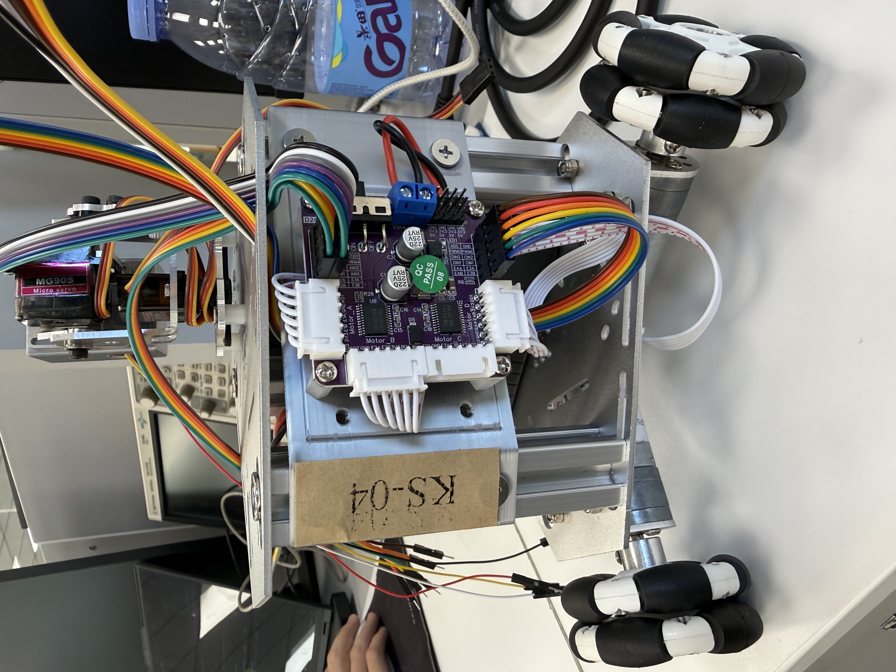

# 清华大学电子技术课程设计 · ESP32-S3 三轮全向小车

这是我们在清华大学 2026 年夏季学期《电子技术课程设计》中制作的 **KS-04 三轮全向小车**。三个全向轮以 120° 布置，小车可以直行、横移和原地转向。固件使用 C 和 ESP-IDF 开发，各任务独立编译和烧录。

## 完成的任务

| 任务 | 小车做了什么 | 固件 |
| --- | --- | --- |
| **任务一 · 红外循迹与避障** | 用四路红外传感器跟随黑线。超声波检测到障碍后，小车左移、前进，再向右找回黑线，最后在 T 形终点停车。 | [`Code/task1_ver2.0`](Code/task1_ver2.0) |
| **任务二 · 摄像头巡线与找球推球** | 从摄像头画面中的一条水平扫描带提取黑线位置，配合超声波完成绕障。回到黑线后，抬起摄像头寻找小球和黑色目标标记，依次对准并推送红球和蓝球。 | [`Code/task2-camera-line`](Code/task2-camera-line) |
| **自主题 · 语音控制与攻城槌** | 用 ESP-SR 离线识别中文命令。说「蓝牙遥控」「语音遥控」或「攻城槌」进入对应模式，说「选择功能」回到菜单。攻城槌模式搜索内容为 `1` 的二维码，结合超声波测距执行对准、撞击和后退，TFT 与喇叭同步播放表情动画和音效。 | [`Code/voice-control-task`](Code/voice-control-task) |

仓库也保留了早期的[红外循迹固件](Code/task1)、[找球和舵机踢球实验](Code/camera-task)以及[独立 BLE 遥控固件](Code/task3-ble-control)。

## 硬件与接线



| 部分 | 课程用车配置 |
| --- | --- |
| 主控与驱动 | ESP32-S3-DevKitC-1、D24A 驱动板、三台带霍尔编码器的 LQ25R8V6 直流电机 |
| 巡线与测距 | LQ-R4CHV 四路红外循迹模块、HC-SR04 超声波模块 |
| 视觉与交互 | JQ-CAM12-720P USB 三合一摄像头、MG90S 云台舵机、SPI TFT 屏幕 |

摄像头的视频和音频分别通过 UVC 和 UAC 在同一根 USB 线上传输。视觉和语音固件使用 **Octal PSRAM**，语音固件按 **16 MB Flash** 配置并使用单独的语音模型分区。

按所选固件核对引脚。[任务一接线](Code/task1_ver2.0/接线说明.md) · [任务二接线](Code/task2-camera-line/接线说明.md) · [语音工程接线](Code/voice-control-task/README.md#硬件接线与-task2-完全一致零改动) · [三合一摄像头接口](docs/USB三合一摄像头接口说明.md)

## 编译与烧录

项目使用 **ESP-IDF v5.4.4**，目标芯片为 `esp32s3`。Windows 上请把仓库放在纯英文路径下，在已激活的 ESP-IDF 终端中运行以下命令。示例使用任务一，换任务时进入上表中对应的固件目录。

```powershell
git clone https://github.com/WJHcd/esp32-car-course-design-thu.git
cd esp32-car-course-design-thu/Code/task1_ver2.0
idf.py build
idf.py -p COM8 -b 115200 flash monitor
```

把 `COM8` 换成实际串口。首次构建视觉或语音工程时，ESP-IDF 组件管理器会按 `main/idf_component.yml` 下载依赖。仓库中的部分 `.bat` 和 `activate-idf.ps1` 脚本使用原开发机的安装路径，在自己的 ESP-IDF 终端里直接运行 `idf.py` 即可。

**接着摄像头时，用 UART0 烧录和看日志。** 摄像头占用原生 USB 的 `GPIO19/20`。使用 3.3 V 逻辑的 USB 转 TTL，连接 `TX → GPIO44`、`RX → GPIO43` 和 `GND → GND`。如果串口线没有自动复位功能，烧录前按住 BOOT、短按 EN，再松开 BOOT。烧录完成后短按 EN 启动固件。

## 实车调试

1. **先检查供电和电机方向。** 电机驱动板与主控共地。使用 5 V 供电的 HC-SR04 时，将 `ECHO` 降到 3.3 V 逻辑电平再接入主控。架空车轮后逐路检查转向和编码器读数。 [电机与编码器诊断](Code/motor-drive-test/接线说明.md)
2. **先看识别，再让车跑。** 在对应工程的 `main/main.c` 设置运行模式并重新烧录。`TASK1_MODE=1` 用于检查红外读数，`TASK2_MODE=9` 用于静态检查红球、蓝球和黑色标记，`TASK2_MODE=8` 用于单独联调推球。两项任务的综合模式均为 `0`。 [任务二调试说明](Code/task2-camera-line/README.md)
3. **换场地后重新标定。** 光照、摄像头角度和地面摩擦会影响识别与行驶。先检查黑线与目标标记能否稳定识别，再调速度和避障时序。 [黑色标记标定](Code/task2-camera-line/tests/BLACK_MARKER_CALIBRATION.md)

单独测试手机遥控时，可烧录 `Code/task3-ble-control`，在支持 Nordic UART Service 的手机应用里连接 `MyCar-BLE`。切回其他任务时重新烧录对应固件。 [BLE 遥控操作说明](Code/task3-ble-control/README.md)
