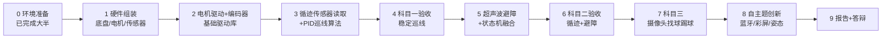

# 电子技术课程设计 · 任务计划

> 2025-2026 学年度夏季学期（2026.8.24 整理）
> 参考：`docs/2026夏 - 电子技术课程设计绪论课讲稿.pdf`

---

## 1. 课程任务概述

| 阶段 | 内容 |
| --- | --- |
| 基本题 | 小车**循迹 + 避障**（科目一：巡线；科目二：循迹+避障） |
| 科目三 | 利用摄像头、多传感器融合，实现三轮小车**找球、踢球** |
| 自主题 | 自主创新功能，第 12 周竞赛 |

### 系统组成

```
                     ┌─ 传感器（输入）── 四路红外循迹 / 超声波 / 摄像头 / MPU6500 …
  ESP32-S3-DevKitC-1 ┼─ 显示（输出）──── TFT IPS 彩屏（SPI）
  （数字处理器）       ├─ 驱动（输出）──── DA24/TB6615 电机驱动
                     └─ 执行器件 ────── 直流电机（带霍尔编码器）/ MG90S 舵机
```

---

## 2. 教学时间安排

| 周次 | 日期 | 任务 |
| --- | --- | --- |
| 第 10 周 | 8.24 ~ 8.28 | 绪论课、组队选题、**小车组装 + 熟悉环境 + 科目一（巡线）** |
| 第 11 周 | 8.31 ~ 9.4 | 电路模块制作与安装、整体调试、**科目二（循迹+避障）**、科目三（找球踢球） |
| 第 12 周 | 9.7 ~ 9.11 | 自主题开发调试、展示答辩（**9.11 上午**） |

> 实验室开放时间：周一 ~ 周五 8:30 ~ 17:00

---

## 3. 器材清单（每组一套）

| 器件 | 型号 / 主芯片 | 用途 |
| --- | --- | --- |
| 单片机 | ESP32-S3-DevKitC-1 | 系统控制 |
| 四路红外循迹模块 | — | 循迹（数字量输出） |
| 超声波传感器 | HC-SR04 | 避障测距 |
| 温湿度传感器 | DHT11 | 环境监测（自主题可选） |
| 三维角度传感器 | MPU6500 | 姿态辅助（自主题可选） |
| 摄像头麦克风喇叭三合一 | ESP-Claw 专用摄像头 | 科目三找球 |
| 电机驱动模块 | DA24 / TB6615 | 驱动直流电机 |
| 直流电机 | LQ25R8V6（带霍尔，编码器 512 AB 相） | 行走 |
| 舵机 | MG90S | 踢球机构 |
| 蓝牙模块 | BT08B | 无线控制（自主题可选） |
| 串口转 USB 模块 | CH340 | 调试 |
| LED 显示屏 | TFT IPS 彩屏（SPI） | 状态显示（自主题可选） |

---

## 4. 完成步骤（从基础任务开始）

### Step 0 — 环境准备 ✅（已完成，2026-08-24）

- [x] VS Code + ESP-IDF（EIM）安装完成
- [x] `blink-led` 工程验证可编译（GPIO38 WS2812，v3.x led_strip API）
- [x] Arduino 快速验证程序（`sketch_jul3b/LED`）
- [x] **烧录验证通过：红灯 0.5s 闪烁**（原生 USB 口需按住 BOOT+RESET 进下载模式）
- [x] 确定主开发方式：**ESP-IDF（C 语言）**为主，Arduino 仅作快速验证
- [x] **串口打印测试通过**：`uart-test` 工程（C:\esp-projects\uart-test）每秒打印 `[uptime] Hello ESP32-S3! counter=N free_heap=...`，用 `idf.py -p COM6 monitor` 查看（115200）

> 备注：工程必须放在纯英文路径（`C:\esp-projects\blink-led`、`C:\esp-projects\uart-test`），中文路径会导致 kconfgen GBK 解码失败；命令行激活需设置 `IDF_TOOLS_PATH`/`IDF_PYTHON_ENV_PATH`/`IDF_PYTHON_CHECK_CONSTRAINTS=0`。

### Step 1 — 硬件组装 ✅（2026-08-24，超声波为保留项）

- [x] 底盘（铝合金三轮麦克纳姆轮 120°）+ 3×LQ25R8V6 电机 + 全向轮组装
- [x] 电池（18650 锂电包）→ XL4005 电源模块 → D24A 驱动板 → ESP32-S3
- [x] 四路红外循迹模块（LQ-R4CHV）装于底盘下方朝地
- [x] 驱动板 D24A 确认：3×TB6612FNG（裸功率级，编码器信号直通排针）
- [x] MG90S 舵机 ×2（踢球机构）、摄像头云台机械结构
- [x] 超声波 HC-SR04 已装于底盘前部（安装说明见 README §6）
- ⏸️ **超声波模块接线/调试 → 保留项**（暂不接线，避开 D24A 占用的 GPIO，待避障阶段再做）

### Step 2 — 电机驱动 + 编码器测速（科目一前置，最重要）🔨 进行中

- [ ] **D24A 三电机驱动测试程序**：LEDC 3 路 PWM（PWMA/B/C，20kHz）+ 6 路方向 GPIO（AIN1/2 等）+ STBY 使能
- [ ] 霍尔编码器（512 AB 相）接 **PCNT** 外设计数（E1A/E1B 等直通排针）
- [ ] 封装 `motor` 驱动：`motor_init()` / `motor_set_speed(id, -100~+100)` / `motor_stop_all()`
- [ ] 封装 `encoder` 驱动：`encoder_init()` / `encoder_get_count(id)`
- [ ] 空载测试：A/B/C 依次正转、反转，观察串口编码器计数 → 验证运动学
- [ ] 前进 / 后退 / 横移 / 原地转向（麦克纳姆轮全向运动学）

### Step 3 — 循迹传感器读取与标定

- [ ] 四路红外 GPIO 读取，串口打印 4 位状态
- [ ] 标定：黑线 / 白底阈值、离地高度、安装间距

### Step 4 — 巡线算法 → 科目一验收

- [ ] 初级：按传感器组合查表（直行 / 左转 / 右转）
- [ ] 进阶：由 4 路状态算出偏差 `error`，**PID 控制**左右轮差速
- [ ] 主循环 10~20ms 一个控制周期，调 `Kp/Ki/Kd`
- [ ] 沿黑线稳定跑圈 → **科目一验收**

### Step 5 — 超声波避障

- [ ] HC-SR04：TRIG 发 10µs 脉冲，测 ECHO 脉宽换算距离（可用 RMT 外设）
- [ ] 验证 20cm 内报警 / 减速

### Step 6 — 循迹 + 避障融合 → 科目二验收

- [ ] 状态机：`巡线 → 检测障碍(减速) → 绕障(原地转向) → 重新寻线 → 巡线`
- [ ] 赛道上整体联调，调阈值和转向时序 → **科目二验收**

### Step 7 — 科目三：摄像头找球、踢球

- [ ] ESP-Claw 摄像头采集 + 颜色识别找球
- [ ] 多传感器融合定位球
- [ ] MG90S 舵机做踢球机构
- [ ] 三轮小车运动学控制 → **科目三验收**

### Step 8 — 自主题：自主创新功能

候选方向（选 1~2 个）：

- [ ] 蓝牙遥控（BT08B + 手机蓝牙调试器）
- [ ] TFT 彩屏显示状态 / 速度 / 路径
- [ ] MPU6500 姿态辅助控制
- [ ] DHT11 环境监测
- [ ] 其他创新点

### Step 9 — 总结报告 + 答辩

- [ ] 全程以**半天为单位**记录工作日志
- [ ] 汇总：技术方案、模块分工、代码、问题分析、创新点、源代码、视频
- [ ] 9.11 上午展示答辩

---

## 5. 总体流程图



---

## 6. 成绩评定

| 项目 | 分值 | 说明 |
| --- | --- | --- |
| 出勤 | 10 | 验收前按时到实验室 |
| 设计和实现 | 60 | 工作量、难度、创新（分组验收评定） |
| 自主题 | 10 | 第 3 周竞赛表现 |
| 交流汇报 | 5 | 每组汇报 |
| 总结报告 | 15 | 按时提交、内容完整、总结到位 |

> 组内按贡献比例互评，据此给出个人评分。

### 总结报告内容要求

1. 课题内容及技术方案
2. 系统模块划分及队员工作分工
3. 数字系统部分详细设计及代码实现
4. 课题开发与调试中出现的问题分析
5. 创新点
6. 附完整源代码
7. 附工作日志（每组以半天为单位）
8. 附作品视频

---

## 7. 技术要点备忘

| 模块 | 技术方案 |
| --- | --- |
| 电机驱动 | TB6615 `IN1/IN2` 方向 + ESP32-S3 **LEDC** PWM 调速 |
| 测速 | 霍尔编码器（512 AB 相）→ **PCNT** 外设计数 |
| 巡线 | 四路红外数字量查表 → 偏差 + **PID** 差速 |
| 避障 | HC-SR04 用 **RMT** 测距；状态机：巡线/避障/恢复 |
| 找球 | ESP-Claw 摄像头颜色识别 + 传感器融合 |
| 开发环境 | VS Code + ESP-IDF（EIM）；编译 `idf.py build`，下载 `idf.py -p COMx flash` |

## 8. 当前进度（2026-08-24）

- [x] ESP-IDF EIM 环境安装完成（排障记录见仓库记忆）
- [x] `blink-led` 工程编译通过
- [ ] **下一步**：硬件组装 → TB6615 电机驱动库 → PCNT 编码器测速 → 巡线
